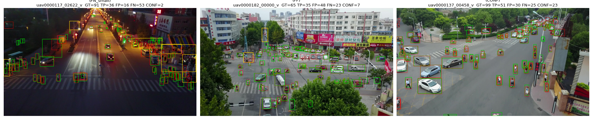
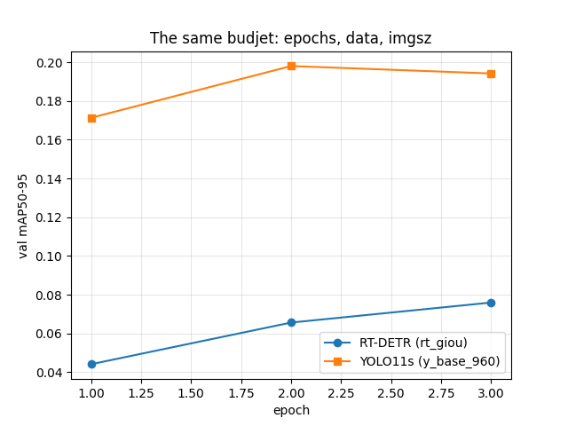
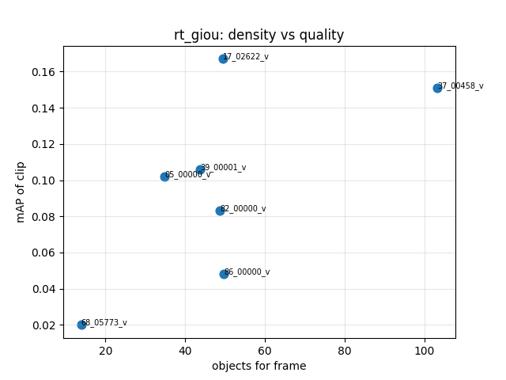

**Note**: Because the Colab sessions crashed several times, the notebook in `code/` does not keep the printed outputs of every cell (for example the Faster R-CNN and RetinaNet training logs in sections 6 and 7). All final metrics used in this report are saved in `code/results/results_all.csv`, and the code of every experiment is in the notebook

## Introduction

The goal of homework was to find and highlight eight classes of things (person, bicycle, car, van, truck, tricycle, bus, motor) in frames from given folders. I used and compared four detectors with one dataset: Faster R-CNN (two-stage), RetinaNet (one-stage, anchor-based), YOLO11 (anchor-free) and RT-DETR (query-based).

Code: `code/HW2_full_notebook_Mykhasiak.ipynb`. W&B project: [hw2-visdrone-vid](https://forge.coreweave.com/wandb/mykhasiak-pn-ukrainian-catholic-university/hw2-visdrone-vid). All validation numbers are got with pycocotools on the 7 validation clips (571 frames, every 5th frame).

## 1. Data understanding and preprocessing

The training set has 56 clips (24,201 frames, 1.1 M objects), validation 7 clips (2,846 frames) and test 48 clips (3,811 frames). The exploration gave interesting clues, which made the final decision.

* **Differences of classes in different datasets.** In training datasets cars (45.7 %) and person (29.7 %) occupy the majority of all objects, bus class takes only 0.9 %. On validation we have the big difference for person (44 %), but slightly for bus (0.2 %), so for rare classes model will have very bad results. This motivated a class-weighted cross-entropy experiment, due to have big fines for rare classes, so model could learn from it.
* **Small objects.** The median size of objects is 45.8 px. Moreover, 24.9 % of objects are less then 32 px, within person this stat raises to 39.5 %. Large objects take only 11.6 % and mostly belong to rare classes. This motivated high input resolution (1280 px. So small objects don`t disappear), small anchors for Faster R-CNN and RetinaNet, so they response to real sizes, and a P2 detection head.
* **Density.** On average we have 45.7 objects per frame (up to 180 maximum), but different clips have different mean from 5 to 143.
* **Ignore regions.** Regions, which are marked as not to use, occur on average 13.2 % of image and 74.7 % of clips contain them. So I checked, if they matter (mask and no mask).
* **Resolution shift.** Size of training images and testing images are very often not the same (many trainings are quite large (1904x1071 and larger), but testing are smaller (960x540 for instance)). One validation clip is 3840x2160, so it damages the work of model.
* **Temporal redundancy.** Adjacent frames are very similar. So it is useless to learn on whole dataset (many frames are almost duplicates), but we can take the piece of dataset to economy calculations.

## 2. Two-stage anchor-based detector: Faster R-CNN

Here I used Faster R-CNN detector.

| run | change | mAP | AP50 | APs | APm | APl | ms/frame |
|---|---|---|---|---|---|---|---|
| frcnn_base | default anchors 32-512 | **0.2367** | 0.4757 | 0.1159 | 0.2216 | 0.4351 | 223 |
| frcnn_anch16 | anchors 16-256 | 0.2291 | 0.4763 | 0.1311 | 0.2188 | 0.4050 | 219 |
| frcnn_prop2k | + more RPN proposals | 0.2236 | 0.4687 | 0.1330 | 0.2096 | 0.4102 | 264 |
| frcnn_wce | anchors 16-256 + class-weighted CE | 0.2228 | 0.4664 | 0.1298 | 0.2113 | 0.3921 | 243 |

None of the changes and improvements improved the default model, but showed worse results. Smaller anchors showed better with small objects, but for medium and large objects their performance decreased the quality of detection. So despite the amount of small objects medium and large objects influence on work of the model significantly.

**Failure cases.** The figure shows three frames of `frcnn_wce` with the most missed small objects, the most false positives and the most class confusions (counts are in the panel titles). All three are dense scenes with 65-99 objects. Plausible causes, which I did not check box by box, are tiny objects in the dark, objects that are unlabeled or in ignore regions, and similar classes such as car and van.

## 3. One-stage anchor-based detector: RetinaNet

Here I did the same, but for RetinaNet detector.

| run | change | mAP | AP50 | APs | APm | APl | ms/frame |
|---|---|---|---|---|---|---|---|
| retina_base | default anchors, focal alpha 0.25 gamma 2, GIoU | **0.1810** | 0.3551 | 0.0675 | 0.1736 | 0.3262 | 249 |
| retina_anch16 | anchors from 16 px | 0.1568 | 0.3377 | 0.0619 | 0.1458 | 0.2841 | 261 |
| retina_focal | + alpha 0.5, gamma 1.5 | 0.1612 | 0.3538 | 0.0705 | 0.1525 | 0.2849 | 251 |

Here we also have interesting situation, as we did previously - none of the improvements beat the baseline. RetinaNet has no proposal stage, so it checks every anchor, and almost all of them are background. I tried focal loss and smaller anchors (16 px) to fix this, but both gave worse results than the default model. RetinaNet is also worse than the best Faster R-CNN.

## 4. One-stage anchor-free detector: YOLO11s

In this section I used YOLO11s, which doesn't use anchors. It draws the mesh. Large objects have several cells, but small can have very few. Detector takes several cells of object and takes these, which the best describe the object. So here we can either enlarge the image, so small objects takes more cells, or increase the amount of cells.

| run | imgsz | epochs | change | min | mAP | AP50 | APs | APm | APl | public |
|---|---|---|---|---|---|---|---|---|---|---|
| y_base_960 | 960 | 3 | baseline | 16.9 | 0.1766 | 0.3583 | 0.0885 | 0.1701 | 0.2960 | 0.2291 |
| y_1280 | 1280 | 3 | resolution | 28.4 | 0.1859 | 0.3715 | 0.1215 | 0.1773 | 0.3092 | 0.2185 |
| y_1280_loss | 1280 | 3 | box gain 10, cls gain 1 | 28.6 | 0.1829 | 0.3695 | 0.1264 | 0.1819 | 0.2901 | 0.2432 |
| y_1280_loss_nomask | 1280 | 3 | ignore regions not masked | 28.2 | 0.1854 | 0.3638 | 0.1239 | 0.1850 | 0.2951 | -- |
| y_final | 1280 | 12 | y_1280_loss, longer | 111.9 | 0.2011 | 0.3909 | 0.1038 | 0.1933 | 0.3204 | **0.2526** |
| y_final (rerun) | 1280 | 12 | same configuration | 108.8 | 0.1993 | 0.3985 | 0.1235 | 0.1988 | 0.3326 | 0.2299 |

The most significant improvements were change of image size and amount of epochs of learnings. However, amount of epochs gave bigger improvement, image size influenced on quality of detection of small objects. YOLO showed better performance compared to previous detectors, but the comparison is not fair due to time of trainings. The difference of results of old run and rerun says it is noise.

## 5. Query-based detector: RT-DETR

RT-DETR-L was trained as y_base_960.

| run | change | mAP | AP50 | APs | min | ms/frame |
|---|---|---|---|---|---|---|
| rt_base | 300 queries | 0.0000 | 0.0000 | 0.0000 | 74.7 | 116 |
| rt_nq500 | 500 queries | 0.0624 | 0.1137 | 0.0224 | 55.0 | 74 |
| rt_giou | GIoU matching cost and loss gain 4 | 0.0877 | 0.1579 | 0.0333 | 56.3 | 82 |

All runs showed worse results than YOLO. Possibly, the reason is 3 epochs are not enough for these type of detector. The `rt_base` training log shows the box loss decreasing, so it performed training, but the classification loss dropped to zero. I didn't investigate it, but the reason could be `rt_base` learned to call every query "background" with no detections. The curve shows the gap: `rt_giou` reaches 0.076 after epoch 3 against 0.194 for YOLO11s.

RT-DETR should not need NMS, but after 3 epochs it still gives many duplicates. Quality per clip does not depend on object density, and small objects are the weakest part.

## 6. My pipeline: separating data, inference and model effects

* **Model.** With the same data and inference, YOLO11s gives the best accuracy with perfect velocity. Faster R-CNN has the highest validation mAP (0.2367) but is much slower.
* **Data.** Masking didn't give any significant result. The size changing (960 -> 1280) increased the performance for small objects.
* **Inference** (final YOLO weights):

| setting | val mAP | APs | ms/frame | public |
|---|---|---|---|---|
| single model | 0.1993 | 0.1235 | 48 | 0.2299 |
| NMS 0.5 / 0.7 | 0.1988 / 0.1988 | 0.1230 / 0.1239 | 43 / 45 | -- |
| input scale x1.2 | 0.2004 | 0.1194 | 50 | -- |
| TTA | 0.2106 | 0.1210 | 69 | -- |
| WBF of best + last checkpoint | 0.2114 | 0.1334 | 93 | 0.2303 |
| WBF + TTA | 0.2144 | 0.1254 | 138 | 0.2217 |

TTA and WBF during experiments gave small improvements for small objects, but on Kaggle performance was bad. So I decided to use simpler pipeline - YOLO11s, 1280 px, 12 epochs, no TTA or ensembling.

**Summary of all runs:**

| run | mAP | AP50 | APs | ms/frame | min |
|---|---|---|---|---|---|
| y_base_960 | 0.1766 | -- | -- | -- | -- |
| y_1280_loss | 0.1829 | 0.3695 | 0.1264 | -- | 28.6 |
| y_final | 0.2011 | 0.3909 | 0.1038 | 57 | 111.9 |
| y_final_tta | 0.2115 | 0.4072 | 0.1077 | 88 | -- |
| frcnn_base | 0.2367 | 0.4757 | 0.1159 | 223 | 25.1 |
| frcnn_anch16 | 0.2291 | 0.4763 | 0.1311 | 219 | 25.7 |
| frcnn_prop2k | 0.2236 | 0.4687 | 0.1330 | 264 | 27.4 |
| frcnn_wce | 0.2228 | 0.4664 | 0.1298 | 243 | 26.3 |
| retina_base | 0.1810 | 0.3551 | 0.0675 | 249 | 22.0 |
| retina_anch16 | 0.1568 | 0.3377 | 0.0619 | 261 | 22.8 |
| retina_focal | 0.1612 | 0.3538 | 0.0705 | 251 | 22.8 |
| rt_base | 0.0000 | 0.0000 | 0.0000 | 116 | 74.7 |
| rt_nq500 | 0.0624 | 0.1137 | 0.0224 | 74 | 55.0 |
| rt_giou | 0.0877 | 0.1579 | 0.0333 | 82 | 56.3 |
| y_1280_loss_nomask | 0.1854 | 0.3638 | 0.1239 | 60 | 28.2 |
| y_p2_1280 | 0.1835 | 0.3857 | 0.1112 | 63 | 41.8 |
| y_p2nop5_1280 | 0.1862 | 0.3925 | 0.1072 | 93 | 40.3 |
| y_final_retrain | 0.1993 | 0.3985 | 0.1235 | 48 | -- |

## 7. Bonus tasks

**Temporal rescoring.** For every detection I found the same object in adjacent frames. If both frames have the same object - score increases. Otherwise, it is random noise. Evaluated on all 2,846 validation frames.

| setting | mAP | AP50 | APs |
|---|---|---|---|
| no temporal | 0.2132 | 0.4130 | 0.1084 |
| w=0.2, IoU>=0.5, window 1 | 0.2162 | 0.4173 | 0.1113 |
| **w=0.4, IoU>=0.5, window 1** | **0.2174** | 0.4178 | 0.1123 |
| w=0.3, IoU>=0.4, window 1 | 0.2161 | 0.4159 | 0.1108 |
| w=0.3, IoU>=0.5, window 2 | 0.2169 | 0.4182 | 0.1137 |

Per clip (best setting):

| clip | obj/frame | mAP before | mAP after | delta |
|---|---|---|---|---|
| uav0000086 | 49.8 | 0.226 | 0.223 | -0.003 |
| uav0000117 | 49.5 | 0.209 | 0.211 | +0.002 |
| uav0000137 | 103.4 | 0.299 | 0.298 | -0.001 |
| uav0000182 | 48.7 | 0.179 | 0.180 | +0.001 |
| uav0000268 | 13.9 | 0.083 | 0.084 | +0.001 |
| uav0000305 | 34.7 | 0.262 | 0.273 | +0.011 |
| uav0000339 | 43.7 | 0.283 | 0.283 | 0.000 |

**Custom architecture: an extra P2/5 detection head.** As it was mentioned above, the majority of our objects are too small for classic YOLO. So the experiment was about to add smaller cells (4x4, P2) and delete too big (32x32, P5).

| run | mAP | APs | APm | APl | params | GFLOPs | min |
|---|---|---|---|---|---|---|---|
| y_1280_loss | 0.1829 | 0.1264 | 0.1819 | 0.2901 | 9.43 M | 88.2 | 28.6 |
| y_p2_1280 | 0.1835 | 0.1112 | 0.1695 | 0.3247 | 9.58 M | 117.8 | 41.8 |
| y_p2nop5_1280 | 0.1862 | 0.1072 | 0.1811 | 0.3276 | 7.09 M | 109.9 | 40.3 |

The P2 found slightly more small objects, but it also caused many fails, overall mAP did not change, and the time of training increased. Removing the P5 head made the model 25 % smaller without hurting mAP. The test was short (3 epochs, one run, a new head trained from scratch), so the result is not final. Neither variant was used in the final model.

**Visualisation (Weights & Biases).** The project contains per-run curves and configurations, validation predictions with boxes for each model family, Grad-CAM maps for hit and miss cases, and a t-SNE of per-object P4/16 neck features (you can find it on the site with link above).

## Conclusion

YOLO11s showed the best performance through good velocity. The best choices, that improved performance, were amount of epochs and image size. TTA and WBF, also P2/5 showed better results with validation, but didn't show better performance at all. Faster R-CNN reached the highest validation mAP (0.2367); RetinaNet and RT-DETR didn't show the best due to amount of epochs was not enough for them.

